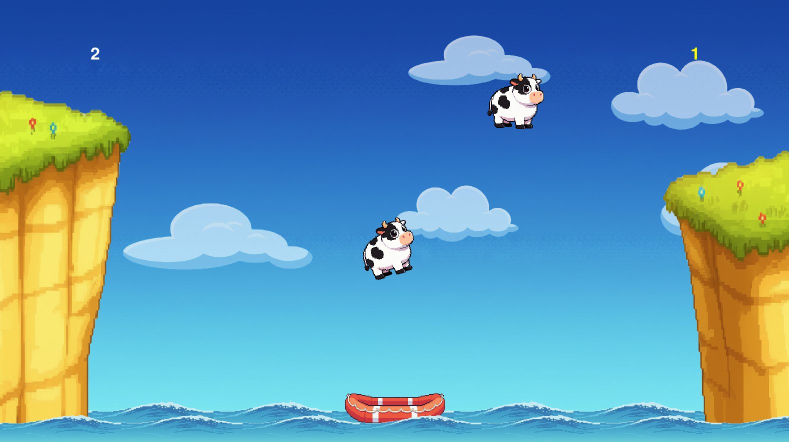

# Cowabunga

[](https://github.com/astral-sh/ruff) [](https://github.com/pre-commit/pre-commit) 

Help the cows cross the river safely!
The game can be played online in browser or locally with Pygame.

[PLAY IN BROWSER](https://nicolapesaresi.github.io/Cowabunga/)



Cowabunga is an amazing iOS game created by Mark Andrade. This repository is just the Pygame recreation of the game made by a fan. All credits for the original idea and game go to Mark Andrade and AndradeArts.  

🌐 [Mark Andrade website](https://markandrade.com)  
👔 [Mark Andrade LinkedIn](https://www.linkedin.com/in/markandrade/)

## Game
Cows are coming from the left side of the screen and have to cross a river. You can help by bouncing them on your lifeboat to the other side. Each cow needs three bounces to cross the river. You have 3 lives to try and save as many as you can.

You control the paddle with your mouse or arrow keys. In browser mode, dragging the paddle on a touch screen should work, but the game is not optimized for mobile and might fail on some devices. If on mobile you get stuck on the pygbag "Ready to start!" loading screen, double tapping under the window usually loads the game. This seems to be an issue with pygbag.

## Structure
The repository is structured as follows:
- In the `cowabunga/env` folder you can find the game environment. This defines the game rules and logic. This is separate from the pygame interface as I intend to train a Reinforcement Learning agent on the game in the future.
- In the `cowabunga/py_game` folder there is the pygame interface for the game env and the assets for the sprites.
- `cowabunga/scripts/run_pygame.py` is the script that makes you play the game on desktop.
- `main.py` is the script that is used by Pygbag to handle pygame in the browser.

Development of the game is ongoing. Sounds and cow sequences will be added soon. 

## Installation
The repository is set up as a [uv](https://docs.astral.sh/uv/) project and by default requires Python 3.10 or later.
To install the repository you can follow these steps:

First, install `uv` if you haven't already, as indicated by the instructions on the [uv installation page](https://docs.astral.sh/uv/getting-started/installation/).
Then, clone the repository to your local machine using the following command:
```
git clone https://github.com/nicolapesaresi/Cowabunga
cd Cowabunga
```
Use uv to create a virtual environment (`.venv`) and install the project dependencies:
```
uv sync --no-dev
```
Now you can run the game on desktop, from the repository root, with:
```
uv run python -m cowabunga.scripts.run_pygame
```

## Development
The game is created with Pygame, and is playable in browser using Pygbag and Github Pages.
The game loop logic lives in `PygameRenderer.update_state()`, which is used both by the desktop loop (`PygameRenderer.run()`) and by the browser loop (`main.py`).
Adding modifications to the game requires to install dev dependencies with 
```
uv sync
```
To test browser functionalities, the game can be run on localhost with the command 
```
uv run pygbag .
```
After testing the changes, they can be deployed in github pages with
```
make publish
```

## Resources
[Pygame documentation](https://www.pygame.org/docs/)  
[Pygbag](https://github.com/pygame-web/pygbag)   
[Pygbag documentation](https://pygame-web.github.io/wiki/pygbag/)  
[Hosting Pygame games with github pages](https://github.com/league-curriculum/Python-Web-Game?tab=readme-ov-file)  
[Mark Andrade website](https://markandrade.com)  
[Mark Andrade LinkedIn](https://www.linkedin.com/in/markandrade/)